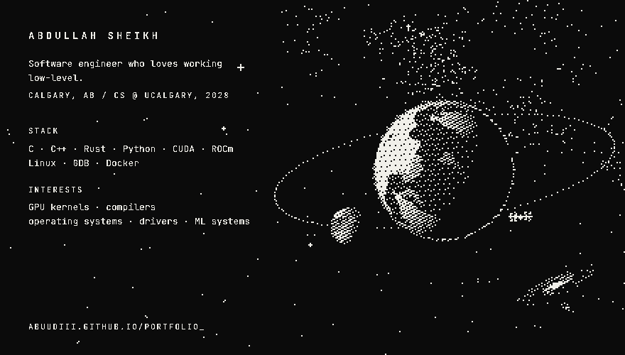

  
  
  
  
  
  
  
  
  
  

<samp>[portfolio](https://abuudiii.github.io/portfolio_/) · [linkedin](https://www.linkedin.com/in/abdullah-tar-gz/) · [email](mailto:sheikh07abdullah@gmail.com)</samp>
